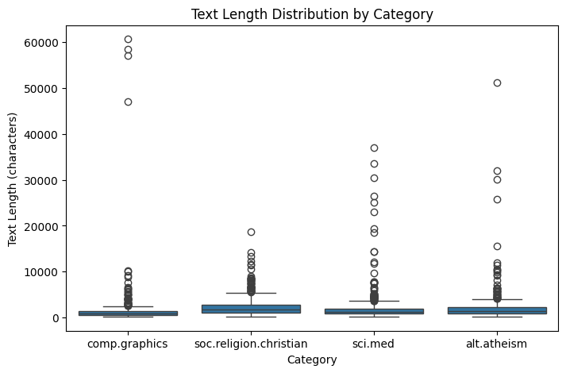
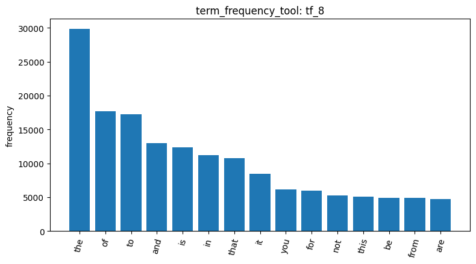
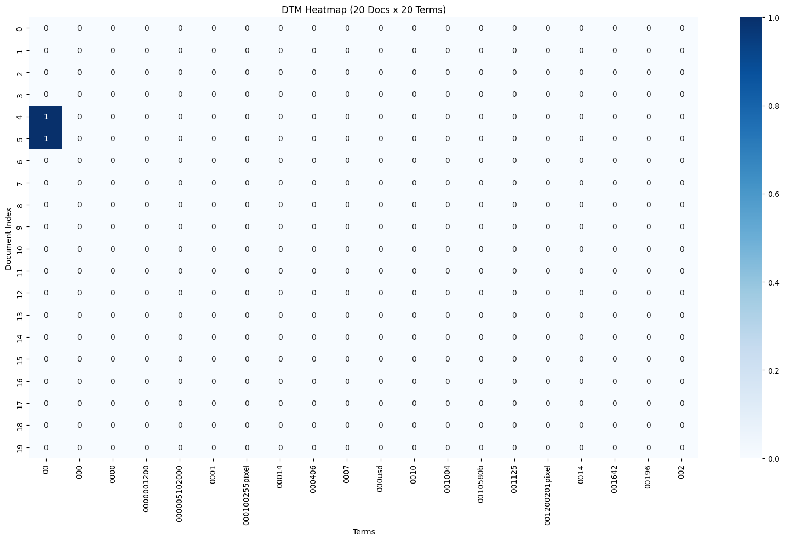
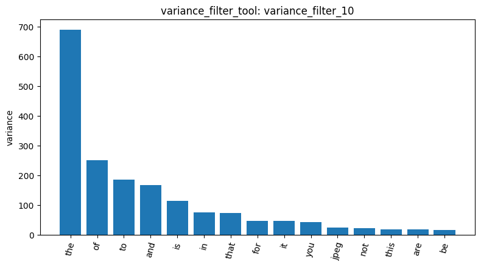
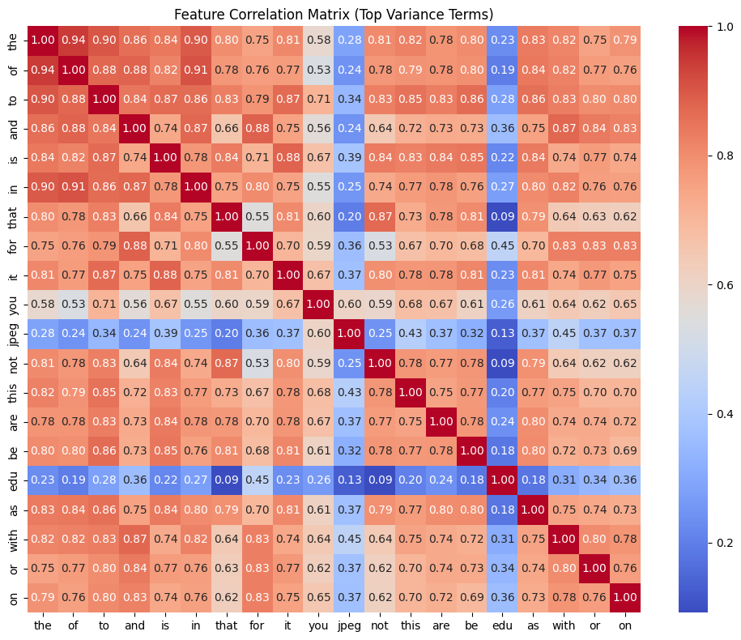
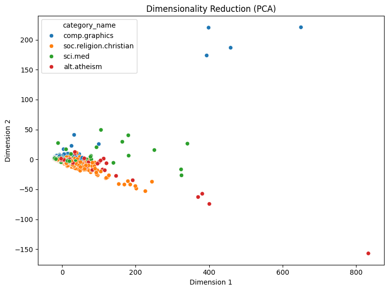
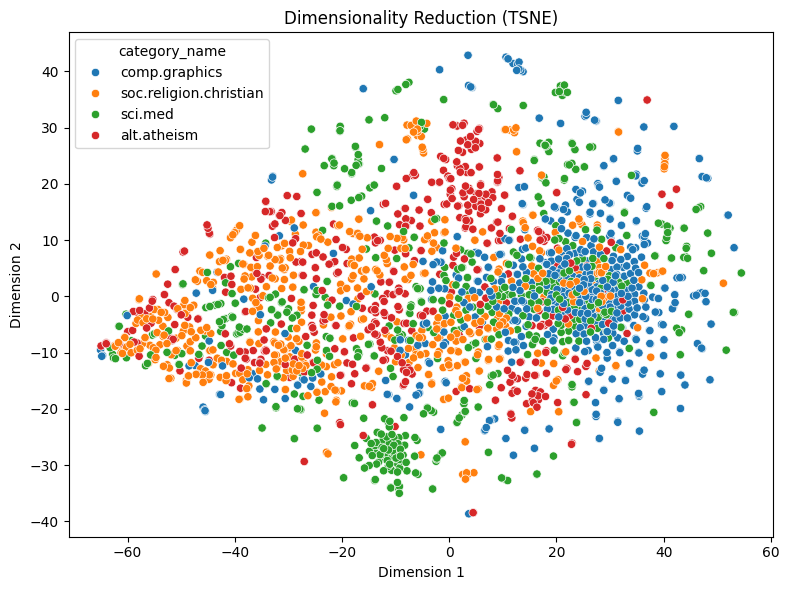
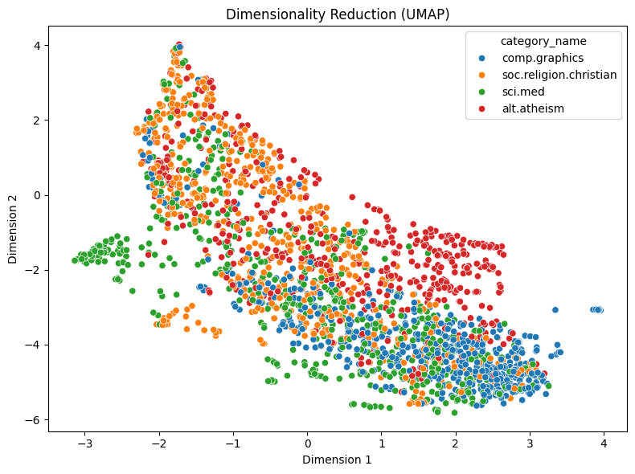

# Agentic Pipeline Report — 20 Newsgroups

**Student:** 蔡喬羽 (115033634)
**Dataset:** 20-newsgroups training split, four categories: `alt.atheism`, `soc.religion.christian`, `comp.graphics`, `sci.med`
**Tools:** the 18 tools I built and tested in AgentDev, plus the premade `load_dataset_tool` and `visualize_result_tool`

> **Note on result IDs.** My analysis ran across three chat sessions in the same log. The kernel was restarted twice (once because the conversation became too long for the LLM backends, once to fix an encoding bug described in §7), and each restart resets the `result_id` counter. I therefore label every ID with its session: **S1**, **S2** or **S3**.

---

## 1. Loading and data quality

`load_dataset_tool` (S1 `load_dataset_1`) loaded **2,257 documents**: `soc.religion.christian` 599, `sci.med` 594, `comp.graphics` 584, `alt.atheism` 480. The classes are roughly balanced, although `alt.atheism` is about 20% smaller than the others.

`inspect_data_tool` (S1 `inspect_data_2`, `n_rows=3`) showed that every post starts with Usenet email headers, e.g. `From: sd345@city.ac.uk (Michael Collier) Subject: Converting images to HP LaserJet III? Nntp-Posting…`. I noted this early because these header words later turned out to dominate several results.

`check_missing_tool` (S1 `check_missing_3`) found **0 missing or empty texts**, and `check_duplicates_tool` with `drop=False` (S1 `check_duplicates_4`) found **0 duplicates**, so nothing was dropped and the working set stayed at 2,257 documents.

`describe_data_tool` (S1 `describe_data_5`) computed text length in characters:

| Category | Mean | Std | Median | Max |
|---|---|---|---|---|
| Overall | 1,992.96 | 3,547.66 | 1,235.0 | 60,713 |
| alt.atheism | 2,167.30 | 3,581.70 | 1,382.5 | 51,239 |
| comp.graphics | 1,557.08 | 4,684.77 | 883.0 | 60,713 |
| sci.med | 2,008.12 | 3,360.44 | 1,238.5 | 37,009 |
| soc.religion.christian | 2,263.18 | 2,080.25 | 1,649.0 | 18,660 |

The distribution is strongly right-skewed: the mean (1,993) is far above the median (1,235). `comp.graphics` is the most interesting case. It has the **shortest typical post** (median 883) but the **largest spread** (std 4,685), driven by a handful of very long posts (the box plot shows four between roughly 47,000 and 60,000 characters). These outliers come back in several later steps. `soc.religion.christian` has the longest typical post (median 1,649) but the smallest spread.

## 2. Tokenization and the document-term matrix

`tokenize_tool` (S1 `tokenize_6`) produced **903,209 tokens**, an average of 400.18 per document.

`build_dtm_tool` with default settings (S1 `dtm_7`) built a **2,257 × 35,788** matrix with **365,886 non-zero cells** out of 80,773,516, giving a **sparsity of 99.547%**. On average a document uses only about 162 distinct terms out of 35,788. Rebuilding the DTM after a restart (S2 `dtm_2`) gave exactly the same numbers, so the pipeline is reproducible.

`term_frequency_tool` (S1 `tf_8`) counted **691,079** total term occurrences. That is about 23% fewer than the NLTK token count, because `CountVectorizer`'s default pattern drops punctuation and single-character tokens. The top 20 terms are almost all stopwords: `the` 29,825, `of` 17,660, `to` 17,222, `and` 13,017, `is` 12,343, … `from` 4,877 and `edu` 4,675 are the only non-stopwords, and both come from the email headers and addresses. I had expected `subject` and `lines` near the top too, but they appear only about once per post (about 2,257 times), which is below the 20th term (`with`, 3,655).

`dtm_heatmap_tool` (S1 `dtm_heatmap_9`, 20 documents × first 20 terms) makes the sparsity visible: 398 of the 400 cells are 0. The first terms alphabetically are noise tokens such as `000100255pixel`, `0010580b` and `001200201pixel`. These look like encoded image data or hex dumps, which is consistent with the very long `comp.graphics` posts.

## 3. Feature filtering: variance vs. correlation

**Variance.** `variance_filter_tool` with `threshold=0.01` (S1 `variance_filter_10`) kept **5,354** terms and removed **30,434** (85%). The variance plot shows that the highest-variance terms are stopwords (`the` ≈ 690, then `of`, `to`, `and`, `is`, …). The only content word in the top 15 is **`jpeg`** (rank 11), which is likely inflated by a few long JPEG-related posts in `comp.graphics`. **Variance measures how much a term's count fluctuates, not how well it separates categories**, so stopwords survive and rare topic words are removed.

**Pearson** with `target_class="comp.graphics"` (S1 `pearson_filter_11`). The strongest |r| was only **0.2778** (`thanks`).
- Positive terms show that `comp.graphics` posts are help requests: `thanks`, `looking`, `hi`, plus technical words `vga` (0.2111), `video`, `card`, `algorithm`, `graphics` (0.1779).
- Negative terms reflect the discussion style of the other groups: `re` (−0.2566) and `writes` (−0.2337) come from reply and quote formatting, and `who`, `people`, `that`, `not`, `what` are argumentative language.
- `rutgers` (−0.1766) is a source artifact. `soc.religion.christian` is moderated through rutgers.edu, so the term reflects where posts came from, not their topic.

**Spearman** with the same target (S1 `spearman_filter_12`) gave much stronger correlations: `graphics` rose from 0.18 (Pearson) to **0.5211**, and clear topic words appeared (`files` 0.3167, `image` 0.3086, `3d` 0.3060, `program`, `file`, `windows`; `god` −0.3073). Metadata such as `rutgers` and `nntp` dropped out. Rank correlation is less affected by the few documents with huge counts, so the "present vs. absent" signal comes through.

However, `that`, `of`, `is`, `in`, `the`, `to` and `was` were all **negatively** correlated with `comp.graphics`. I asked whether Spearman was partly measuring document length. Since `comp.graphics` posts are the shortest (median 883), they contain fewer stopwords, so their stopword counts rank low. **Part of the Spearman signal is therefore document length rather than topic.** Normalising by length (e.g. TF-IDF) would reduce this.

**Feature correlation** (S1 `feature_corr_13`, top 20 terms by variance). The stopwords are strongly inter-correlated: `the`–`of` 0.94, `the`–`to` 0.90, and most pairs fall between 0.7 and 0.9. Long documents contain more of every function word, so these terms rise and fall together. This is the same length effect seen above. `edu` correlates weakly with everything (0.09–0.45) because it comes from headers, which are roughly constant per post regardless of length. `jpeg` is also only weakly related to the stopwords (about 0.2–0.45, except `you at 0.60), which supports the idea that its high variance comes from a few specific documents.

## 4. Document similarity

With the raw-count DTM (S2 `dtm_2`), `cosine_similarity_tool` gave:
- docs 0 vs 1, both `comp.graphics`: **0.3532** (S2 `cosine_sim_3`)
- docs 0 vs 2, `comp.graphics` vs `soc.religion.christian`: **0.3399** (S2 `cosine_sim_4`)

The two scores are almost identical, so **raw-count cosine similarity barely distinguishes same-topic from different-topic pairs here**. Shared stopwords and header terms dominate the vector direction. The fixes would be stopword and header removal, TF-IDF weighting, or a `max_df` cutoff in `build_dtm_tool`.

`binarize_labels_tool` (S2 `binarize_labels_5`) one-hot encoded the labels into a **2,257 × 4** matrix (classes in alphabetical order; counts 480 / 584 / 594 / 599, matching the load step). Rows 0–1 are `[0,1,0,0]` (`comp.graphics`) and row 2 is `[0,0,0,1]` (`soc.religion.christian`), consistent with `inspect_data_2`. This is the explicit one-vs-rest target behind the correlation filters.

## 5. Dimensionality reduction

**PCA** (S2 `reduce_dimensions_6`): explained variance ratio **0.6594** for PC1 and **0.0433** for PC2. One component capturing two-thirds of the variance in a 35,788-term matrix fits the length effect above: PC1 is essentially a document-length axis. In the plot, most documents overlap near the origin and longer posts stretch to the right. The four isolated `comp.graphics` points high on PC2 (y ≈ 170–220) match the four very long `comp.graphics` outliers from `describe_data_5`.

**t-SNE** (S2 `reduce_dimensions_7`, `random_state=42`, perplexity 30) separates the topics better. `comp.graphics` forms a dense group on the right, and the two religion groups occupy the left. However, `alt.atheism` and `soc.religion.christian` are heavily mixed, which is expected since they share vocabulary (god, jesus, bible). `sci.med` is the most scattered but has one tight island near (−10, −30).

**UMAP** (S2 `reduce_dimensions_8`, `random_state=42`, `n_neighbors=15`) produces one continuous band. Religion and `sci.med` sit at the upper left, and `comp.graphics` forms the densest cluster at the lower right, with `sci.med` in between. Unlike t-SNE, part of `alt.atheism` separates into its own strip (around x = 1–3.5, y = −1 to −2). A tight `sci.med` island appears again on the left. Because **two different algorithms both isolate that sci.med subgroup**, it is likely a real subgroup (for example a single thread or FAQ series) rather than an artifact of one method.

| Method | What it showed on this data |
|---|---|
| PCA (linear) | Dominated by document length; heavy overlap |
| t-SNE | Clear local groups (graphics vs. religion); distances between groups not meaningful |
| UMAP | Local groups plus a global ordering (graphics ↔ sci.med ↔ religion); partially separates atheism |

## 6. Frequent pattern mining

`mine_patterns_tool` with `filtering_method="tfidf"`, `algorithm="topk"`, `k=20`:

**comp.graphics** (S3 `mine_patterns_2`). All 20 patterns are header words:
- `{lines}` and `{subject}` have support 584, i.e. every post in the category
- `{organization}` 560
- `{edu}` 320 (about 55% of posts)
- `{posting}` 288 and `{host, lines}` 276, from `Nntp-Posting-Host`

No topic word appears at all.

**soc.religion.christian** (S3 `mine_patterns_3`). The header structure is identical: `{lines}` and `{subject}` 599 (every post), `{organization}` 536, `{edu}` 465 (about 78%). Here a topic word does reach the top 20: **`{god}` with support 344**, i.e. 57% of posts. `{lines, writes}` (326) also appears, reflecting the reply culture, which matches `writes` being negatively correlated with `comp.graphics` in `pearson_filter_11`. `rutgers` did not reach the top 20.

Interpretation: the per-category vectorizer removes English stopwords, but header words such as `lines`, `subject` and `organization` are not stopwords. TF-IDF filtering keeps the top 80% of terms, so these words survive, and Top-K ranks by support, so they always come first. Religion vocabulary is concentrated enough that `god` still breaks through. Graphics vocabulary is spread across many specific terms (jpeg, vga, image, 3d, …), none of which reaches the support of the headers. To make the patterns reflect topics, the headers should be removed before vectorising, e.g. `fetch_20newsgroups(remove=('headers','footers','quotes'))` or a custom stop list.

## 7. A real bug found on real data

My first `mine_patterns_tool` call in S2 failed with `UnicodeEncodeError: 'cp950' codec can't encode character '\xe9'`. The tool writes the transactional database to a temporary file through PAMI's `DF2DB`. On my Traditional-Chinese Windows system, Python's default file encoding is cp950, which cannot represent terms such as `é`. My AgentDev tests passed because the fixture only contains ASCII words (alpha, beta, …), so **the tests never covered non-ASCII text**. I enabled Python's UTF-8 mode (`PYTHONUTF8=1`), restarted, and the same calls then succeeded (S3). A more robust fix would be to make the tool independent of the system encoding, and to add a non-ASCII term to the test.

## 8. Conclusions

1. **Raw counts with stopwords and headers kept are dominated by document length and format, not topic.** This single cause explains several results: stopwords having the highest variance, the high stopword inter-correlation, PCA's 66% first component, nearly identical cosine scores across topics, and header-only frequent patterns.
2. **Rank-based and neighbourhood-based methods recover more topic signal than linear ones.** Spearman beats Pearson, and t-SNE/UMAP beat PCA, though Spearman still partly reflects length.
3. **The categories differ in style as well as vocabulary.** `comp.graphics` posts are short help requests (`thanks`, `looking`, `hi`); the religion groups are long, argumentative reply threads (`writes`, `re`, `people`, `not`). `alt.atheism` and `soc.religion.christian` are the hardest pair to separate.
4. **Next steps** would be to strip headers and quotes, use TF-IDF or a `max_df` cutoff, and repeat the similarity, reduction and pattern-mining steps to measure how much cleaner the topic structure becomes.