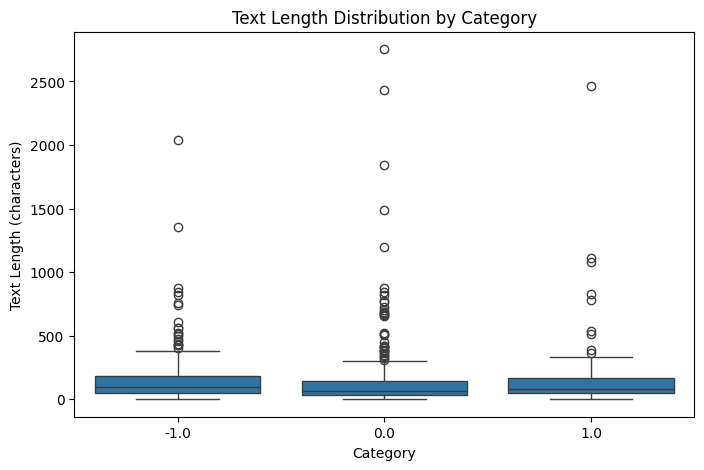
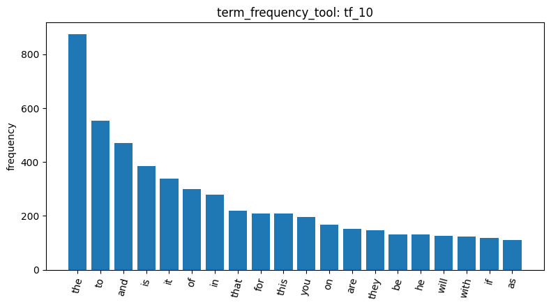
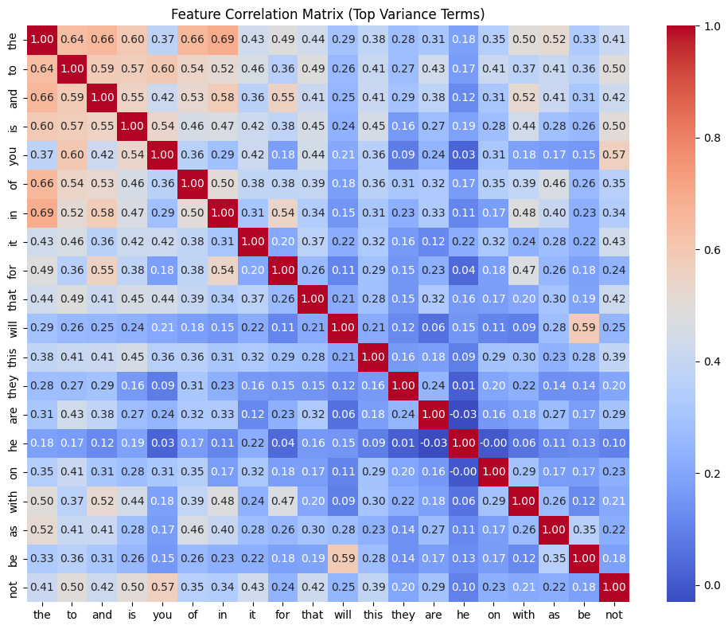
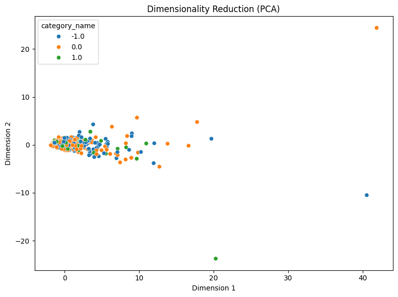
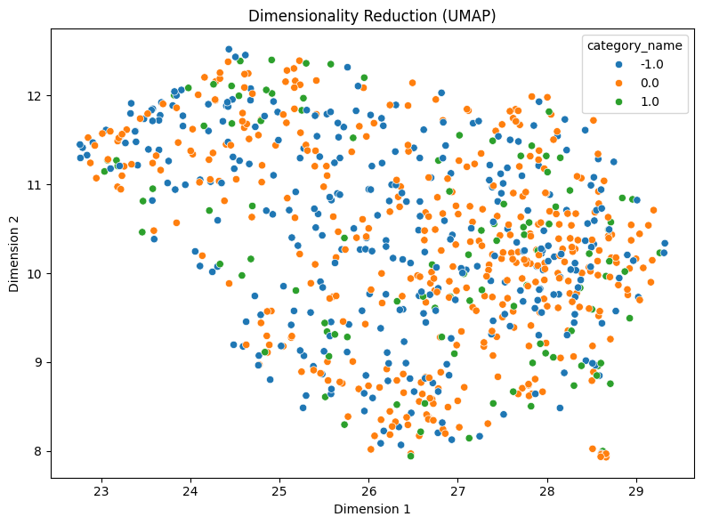

# Homework Report: Reddit Stock Sentiment

**Student:** 蔡喬羽 (115033634)
**Dataset:** `newdataset/Reddit-stock-sentiment.csv`, Reddit posts and comments about stocks labelled `-1.0` (negative), `0.0` (neutral) and `1.0` (positive)
**Tools:** the 18 tools I built in AgentDev plus the premade `load_dataset_tool` and `visualize_result_tool`, run in the same order as the 20-newsgroups pipeline so the two datasets can be compared directly

---

## 1. Finding, loading and inspecting the data

I first used my own `list_files_tool` on `newdataset/` (`list_files_1`) to confirm the file name: `Reddit-stock-sentiment.csv`, with no subdirectories. `load_dataset_tool` (`load_dataset_2`, `text_column="text"`, `label_column="label"`) then loaded **847 documents**:

| Label | Count | Share |
|---|---|---|
| `0.0` neutral | 423 | 50% |
| `-1.0` negative | 315 | 37% |
| `1.0` positive | 109 | 13% |

The classes are strongly imbalanced, and positive is a small minority. That matters for every class-level result below.

`inspect_data_tool` (`inspect_data_3`, `n_rows=5`) showed data that looks nothing like 20-newsgroups:
- **No email headers.** Posts are short, often a single sentence, e.g. "Calls on retards" or "He didn't say thank you."
- **WallStreetBets slang and finance jargon.** "calls" means a bullish options bet, and "red" means prices falling.
- **Labels look noisy.** "Seeing lots of red in the ticker." is labelled *neutral*, although "red" means a falling price, and "Calls on retards" is labelled *negative*, although "calls" is bullish. The labels seem to come from a general-purpose sentiment scorer that does not understand stock-market language.
- **Non-ASCII characters**, such as the curly apostrophe in "didn't".

## 2. Data quality: duplicates matter here

`check_missing_tool` (`check_missing_4`) found **0** missing texts.

`check_duplicates_tool` with `drop=False` (`check_duplicates_5`) found **23 duplicates involving 34 rows**. Unlike 20-newsgroups, which had none, Reddit contains repeated text: 34 − 23 = 11 distinct texts appear several times each. Repeated text would inflate term frequencies and pattern support, so I dropped every copy with `drop=True` (`check_duplicates_6`), matching Master's `keep=False`. This left **813** documents, as I had predicted.

`describe_data_tool` (`describe_data_7`) gave the per-class counts after the drop. They show where the duplicates came from:

| Label | Before | After | Removed |
|---|---|---|---|
| `-1.0` | 315 | 315 | 0 |
| `0.0` | 423 | 391 | **32** |
| `1.0` | 109 | 107 | 2 |

**32 of the 34 removed rows were neutral.** This is consistent with the duplicates being bot or boilerplate replies, which carry no sentiment. Removing them also removed some noise from the neutral class.

Text length in characters (`describe_data_7`):

| | Mean | Std | Median | Max |
|---|---|---|---|---|
| Overall | 148.31 | 241.43 | **80.0** | 2,753 |
| `-1.0` | 153.74 | 192.13 | 96.0 | 2,040 |
| `0.0` | 139.08 | 260.46 | 68.0 | 2,753 |
| `1.0` | 166.04 | 294.71 | 81.0 | 2,461 |

The median post is **80 characters, about 15× shorter than 20-newsgroups (1,235)**. The shortest is a single character. Negative posts have the longest median (96), while neutral posts are the shortest (68), mostly brief replies. The distribution is again right-skewed (mean 148 versus median 80).

## 3. Tokens, document-term matrix and frequent terms

`tokenize_tool` (`tokenize_8`) produced **25,287 tokens**, only **31.10 per post** (20-newsgroups: 400).

`build_dtm_tool` with default settings (`dtm_9`) produced an **813 × 4,313** matrix with 16,659 non-zero cells and **99.52% sparsity**:

| | 20-newsgroups | Reddit |
|---|---|---|
| Vocabulary | 35,788 | **4,313** (≈8× smaller) |
| Sparsity | 99.547% | **99.52%** |
| Distinct terms per doc | ≈162 | **≈20.5** |

The vocabulary and the number of terms per post both shrink by a similar factor, so sparsity stays at about 99.5%. **Extreme sparsity is a property of text itself, not of one dataset.**

`term_frequency_tool` (`tf_10`) counted 20,315 term occurrences. As I predicted, the top 20 are all stopwords (`the` 874, `to` 554, `and` 471, `is` 386, …), and there is no `edu` or `from`, confirming there are no headers. Two terms differ from 20-newsgroups: **`he` (132)** and **`will` (127)**. `will` reflects speculative, forward-looking talk ("it will…"), and `he` turns out to be connected to political discussion (§6).

## 4. Feature filtering

**Variance** with the same `threshold=0.01` as on 20-newsgroups (`variance_filter_11`) kept **490** and removed **3,823** terms (**88.6%**, versus 85% on 20-newsgroups). Short posts mean most terms occur only once or twice, so their variance is tiny.

**Pearson** with `target_class="1.0"` (`pearson_filter_12`). Correlations are very weak: the maximum is **0.1563** (`huge`, `main`, `tldr`), compared with 0.28 on 20-newsgroups. Many terms share identical values: 0.1286 for 5 terms and **0.1276 for 8 terms** (`3d`, `amd`, `catch`, `crush`, `cutting`, `dividends`, `exciting`, `ice`). When I asked why, the explanation was that an identical value means an identical occurrence pattern: each such term appears in a single positive post and nowhere else. **On a small, sparse, imbalanced dataset, Pearson mostly ranks rare words.** Some genuinely positive words still appear (`nice`, `potential`, `exciting`, `perfectly`), but the words I expected (`good`, `buy`) do not, because they occur in all three classes.

**Spearman** with the same target (`spearman_filter_13`) gave **almost the same list** (maximum 0.1609 for `technology`; new entries are `trend` and `electric`). On 20-newsgroups, Spearman had raised `graphics` from 0.18 to 0.52, because long posts give heavily skewed counts that ranks smooth out. Here almost every count is 0 or 1, so ranks and raw values carry the same information. **Spearman's advantage only appears when counts are skewed.** A `min_df` cutoff in `build_dtm_tool` would be the natural fix for the rare-word problem.

**Feature correlation** (`feature_corr_14`) over the top-20 variance terms (all stopwords). Correlations are **much weaker than on 20-newsgroups**: mostly below 0.5, with a maximum of about 0.69 (`the`–`in`), compared with 0.7–0.94 there. With short posts, the document-length effect almost disappears. Two exceptions stand out:
- **`will`–`be` = 0.59**, which reflects the phrase "will be", not document length.
- **`he` is nearly uncorrelated with everything** (−0.03 to 0.22), meaning it is concentrated in a specific subset of posts.

## 5. Dimensionality reduction

**PCA** (`reduce_dimensions_15`): PC1 **26.70%**, PC2 **5.12%**, 31.82% in total, compared with 65.9% for PC1 on 20-newsgroups. Without a dominant length effect, no single axis explains most of the variance. The three sentiments overlap completely near the origin, and only a few long posts stretch out along PC1.

**UMAP** (`reduce_dimensions_16`, `random_state=42`): again **no grouping by sentiment**. The three colours are spread evenly across the whole map. On 20-newsgroups, UMAP separated `comp.graphics` clearly and even part of `alt.atheism`.

This is the central contrast between the two datasets. **Topic is carried by which words appear** (graphics/jpeg versus god/jesus), so bag-of-words works. **Sentiment depends on context and word order** ("calls" being bullish, "red" meaning down, "not good"), which bag-of-words discards. Combined with the noisy labels seen in §1, the sentiment signal is simply not in the word counts.

## 6. Frequent pattern mining: what each sentiment talks about

`mine_patterns_tool` with `filtering_method="tfidf"`, `algorithm="topk"`, `k=20`. On 20-newsgroups every top pattern was an email-header word. Here, with no headers and English stopwords removed, **real content words appear**.

| | Negative `-1.0` (`mine_patterns_17`) | Positive `1.0` (`mine_patterns_18`) |
|---|---|---|
| Distinctive | **`trump` 45**, **`china` 33**, `economy` 17, `trade` 14, `fuck` 14, `don` 15, `doesn` 14 | **`good` 12**, `better` 5, `new` 5, **`technology` 5**, `silver` 5, `hold` 4 |
| Shared | `just`, `like`, `going`, `think`, `time`, `economy`, `tariffs`, `market` | (same) |

- **Negative posts are about politics and the trade war.** `trump` appears in about 14% of negative posts, together with `china`, `tariffs`, `trade` and `economy`. This also explains the isolated **`he`** in `tf_10` and `feature_corr_14`: it most likely refers to Trump, used only within this cluster of political posts. The language is also more emotional and negated: profanity (`fuck`) and `don`/`doesn`, the remains of "don't"/"doesn't" after `CountVectorizer` splits the apostrophe.
- **Positive posts are about opportunity:** `technology` (also Spearman's top term in `spearman_filter_13`), `silver`, `hold`, `new`, `better`.
- **The heavy shared vocabulary**, including `tariffs`, `economy` and even `good` (12 positive vs 13 negative, the latter likely "not good" or sarcasm), is exactly why UMAP and the correlation filters cannot separate the classes.
- **Every top pattern is a single item**, with low supports (maximum 45, versus 584 on 20-newsgroups). Posts are too short for two content words to co-occur often.

## 7. Conclusions

1. **The same tools behave very differently on short, informal text.** The vocabulary is 8× smaller, but sparsity is unchanged at 99.5%. The document-length effect that dominated 20-newsgroups (stopword correlations, PCA's 66% PC1) mostly disappears.
2. **Data cleaning mattered here.** 34 duplicate rows, 32 of them neutral, were removed, whereas 20-newsgroups needed no cleaning.
3. **Correlation filters are unreliable on a small, imbalanced class.** They rank single-occurrence words, and Pearson and Spearman coincide because the counts are essentially binary.
4. **Bag-of-words separates topics but not sentiment.** Negative and positive posts differ in *what* they discuss (trade war versus technology and opportunity), but they share most of their vocabulary, and sentiment depends on context, negation and finance-specific meaning. Noisy labels make this harder still.
5. **Next steps:** `min_df` to remove one-off words, n-grams (e.g. `ngram_range=[1,2]`, to capture "not good" and "will be"), TF-IDF weighting, and ideally domain-aware sentiment labels.