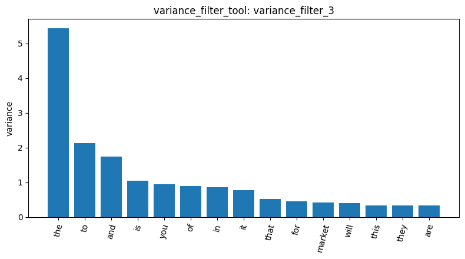

# Homework Report: Reddit Stock Sentiment Analysis

## 1. Dataset Loading
I used `load_dataset_tool` to load the Reddit Stock Sentiment dataset from `newdataset/Reddit-stock-sentiment.csv`, specifying `text` as the text column and `label` as the label column. The tool returned `load_dataset_1`, containing 847 Reddit posts and comments. The dataset included 315 negative, 423 neutral, and 109 positive samples. Neutral sentiment was the most common category, while positive sentiment had the fewest samples.

## 2. Document-Term Matrix Construction
After obtaining permission to use my custom tools, I executed `build_dtm_tool` with `ngram_range=[1, 1]` to construct a unigram document-term matrix (Result ID: `dtm_2`). The matrix contained 847 documents and 4,346 unique terms, with 17,193 nonzero entries out of 3,681,062 total elements. Its sparsity was 99.5329%, indicating that most terms appeared in only a small portion of the documents.

## 3. Variance-Based Feature Filtering
I used `variance_filter_tool` with a threshold of 0.01 to identify and remove low-variance features (Result ID: `variance_filter_3`). Among the original 4,346 features, 506 were retained and 3,840 were removed, representing approximately 88.4% of the original feature space. This substantially reduced the number of features available for further analysis. However, variance-based filtering does not necessarily identify the most informative words for sentiment classification.

## 4. Visualization and Interpretation
I used `visualize_result_tool` to visualize the variance filtering result (`variance_filter_3`). The generated bar chart was saved as `plots/蔡喬羽_homework_plot_turn32.png` and displayed the 15 highest-ranked features by variance. The chart shows a clear difference between the highest-variance feature and the remaining features. This visualization helps illustrate how word frequencies vary across documents, although additional analysis would be needed to determine which features are most useful for predicting stock sentiment.

